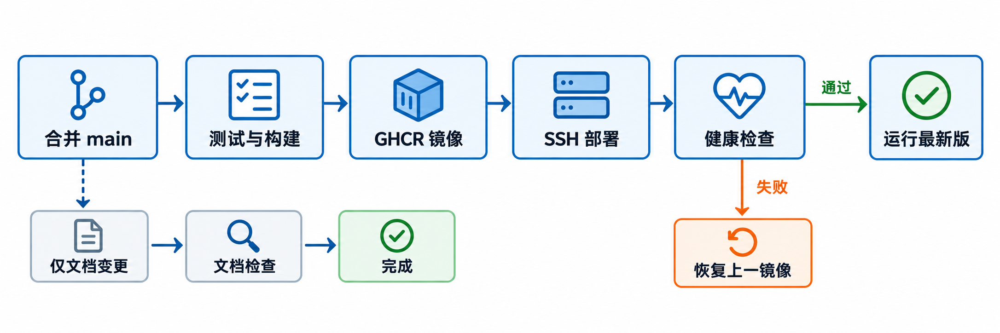

# Fullish

[](https://github.com/weiuou/Fullish/actions/workflows/pipeline.yml)
[](pyproject.toml)
[](https://nonebot.dev/)
[](docs/deployment-ssh.md)

可自托管、可扩展的 QQ AI 群友：理解群聊、适时接话，开发者可通过私聊菜单管理群功能。

已接入 CPA / Gemini 和 QQ 官方适配器；配置凭证后可在群内聊天。[接入指南](docs/qq-setup.md)

[私聊开发者菜单](docs/group-control.md)：一次绑定后，在 QQ 中动态开启或关闭各群的聊天、搜索、生图、沙箱。

## 快速开始

```sh
uv sync --locked
uv run python -m fullish
```

## 自动更新



代码合并 `main` 后自动部署；纯文档修改跳过镜像构建、Package 发布和部署。[查看 CI 规则](docs/ci.md)

## 文档

[本地开发](docs/development.md) · [参与贡献](CONTRIBUTING.md) · [架构](docs/architecture.md)

[SSH 部署](docs/deployment-ssh.md) · [TAT 部署](docs/deployment.md) · [路线图](docs/roadmap.md)
