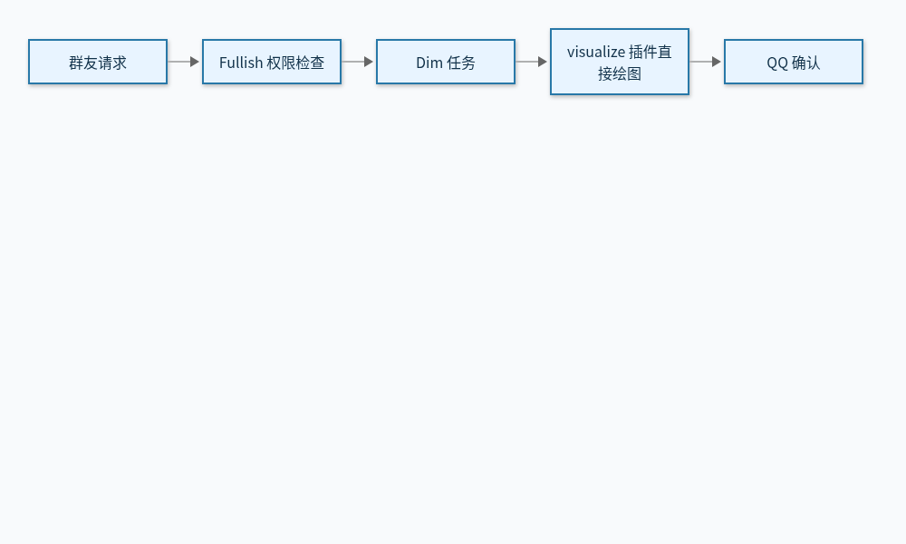

# Dim 与 visualize 接入及验证

状态：直接渲染已合并部署，继续显式单群试运行。日期：2026-11-12。接口与迁移设计见 [Issue #48](https://github.com/weiuou/Fullish/issues/48)，排版回归见 [Issue #46](https://github.com/weiuou/Fullish/issues/46)，后续范围见 [开发路径](agent-runtime-plan.md)。旧版沙箱渲染曾完成单群试运行，其结果仅作为[历史证据](archive/2026-11-12-agent-sandbox-runtime.md)。

## 已实现的接入结构

同容器与只读自检的候选变更正在验证，见[同容器指南](unified-runtime.md)。下述部署记录仍对应已上线的独立 companion，不代表候选已切换。

Fullish 为 `DIM_ALLOWED_GROUPS` 中的具体群选择 Dim 回复后端，每条被叫到的消息建立独立任务会话。Dim 使用固定 `dimcode-alpha@0.1.0-alpha.20` 原生 App Server v3，rutis 插件 SDK/runtime 固定 `0.19.3`，visualize 插件版本为 `0.2.0`。Fullish 保留群上下文、身份、权限、队列和最终投递确认；Dim 群关闭额外的表达后处理。

`visualize_render` 是实际执行绘图的 rutis 工具：插件在专用 Dim companion 内创建私有临时目录，直接调用 Chromium 渲染 SVG、Mermaid 或 HTML，返回真实 PNG 给模型检查，结束时删除临时文件。Fullish 不执行绘图源码，也不为该工具调用 `ToolRuntime`、群沙箱或 broker。通用沙箱仍按原配置独立运行。

插件先通过私有桥接请求一次绘图票据，Fullish 绑定 run/session、真实群和事件，并检查聊天与图片权限；随后只接收该票据对应的一次有界 PNG。接受图片、选择最终候选和实际投递前均重新核对权限。模型不能传群身份、宿主机路径、浏览器启动选项或任意命令。图片产物只属于本轮；`fullish_reply` 登记候选，由公共发送服务获得 QQ 确认后才写历史。

每任务最多两次绘图，桥接候选/绘图请求最多 12 次；单次渲染最多 25 秒，总任务仍为 90 秒。原生模型开始事件超过 16 次会撤销运行并请求停止，这不是精确计费配额。每次模型输出上限为 8192 tokens。取消会撤销桥接授权；插件关闭浏览器、清理临时目录，专用看门狗负责停止超期或失去控制端的会话。无法确认停止的执行标为不明，不自动重跑。

根 SVG 使用块布局，修复满画布 SVG 和纵向 Mermaid 的基线溢出误判；真实溢出仍拒绝。错误只返回固定代码，如 `dim_render_canvas_content_clipped`、`dim_render_external_resource_rejected`、`dim_render_timeout`，未知错误为 `dim_render_failed`。关联日志只记录运行、格式、尺寸、耗时和安全错误码，不记录源码或浏览器原始异常。

最小运行登记位于 `GROUP_CONTROL_DIR/agent-runs.sqlite3`，只保存事件摘要、run/session 与执行/投递状态；不保存可重放内容。相同事件不再次执行，重启后的未决运行标为不明。已知终态保留七天，未决记录不自动过期，不提供自动补发。

## 当前验证证据

| 层次 | 结果与边界 |
| --- | --- |
| 原生协议与插件 | 真实 Windows alpha.20、受保护 named pipe、rutis 原生工具与 `visualize.probe` 已通过 |
| 直接浏览器 | 真实 Chromium 生成三种中文 PNG，拒绝远程/文件子资源与溢出；取消后目录回收且可继续绘图 |
| 完整内部链路 | 真实 Dim、插件、浏览器、Fullish 授权/媒体/投递服务；两次真实 PNG 到达模型请求，最终图片字节一致，模拟 QQ 确认后只记一条回复 |
| Linux 镜像与发布门禁 | [CI 已通过](https://github.com/weiuou/Fullish/actions/runs/43236958746)：真实 companion、私有 Unix RPC、1 GiB/256 PIDs、无 broker 完整流程与发布前后探针 |
| 实际模型与 QQ | 直接渲染版已完成一次真实受控验收，QQ 图文确认；旧沙箱记录仍单独归档 |

模型与 QQ fixture 属于外部模拟边界，不证明生产模型、真实 QQ 或长期稳定性。旧版验收与固定二进制摘要保存在上述历史记录。

## 2026-11-12 直接渲染上线记录

[PR #47](https://github.com/weiuou/Fullish/pull/47) 合并为 `d8be3cf90389b3fcb1ea5bc67b00431ce08c4774`，经[主分支发布流程](https://github.com/weiuou/Fullish/actions/runs/43238245364)部署。仅保留一个既有试运行群，未扩大群授权；生产健康检查确认 Dim 后端、直接绘图和 QQ 连接就绪，companion 未挂载 broker 或 Docker socket。

受控验收使用真实 `gpt-6-luna`、Dim、rutis 与 Chromium，通过 Fullish 内部对话和公共发送服务生成中文流程图，查看并修改一次，再取得真实 QQ 图文确认。共 5 次模型请求、2 次插件绘图，至确认约 33.4 秒；确认后只写一条回复历史。PNG 为 1000 × 600、15662 字节，SHA-256 为 `f0d5af5ab96daf14bf82202edf81aac7d73bcab4f1479e244e164f07c1c2eb93`。输入为明确标记的部署验收内容，没有伪造 QQ 入站事件；正常群聊、长期质量、耗时和容量继续观察。

首次验收脚本漏传群策略目录，虽已得到 PNG，但公共发送权限检查在 QQ 发送前将其拦截，未发送也未记回复。修正验收环境并显式读取现有群策略后，使用独立验收任务完成上述确认；没有修改群权限或重投不明消息。



bot 镜像为 `ghcr.io/weiuou/fullish@sha256:07e10a3858c55cb3f51319f5bd62da48b1b7764c575ae0f8338f179d518c11f8`，专用 companion 为 `fullish.local/agent@sha256:930049ffb69624b897d8da140ec51b2ec5f374fdae2ee5ee0dd90e00046a4b03`。后者从固定源码在服务器构建并以不可变摘要使用，`fullish.local` 不能从外部仓库拉取，维护者须保留镜像与私有 rollout 备份，或先发布到可用仓库。运行配置为 `DIM_VISUALIZATION=true`，旧 `SANDBOX_VISUALIZATION=false`，避免旧 bot 回退后重新启用旧绘图路径。

## 本地开发与探针

```sh
uv sync --locked --group deploy
npm ci --ignore-scripts --prefix plugins/visualize
npm ci --ignore-scripts --prefix plugins/visualize/renderer
uv run --locked python scripts/probe_dim.py --executable /absolute/path/to/dimcode
uv run --locked python scripts/probe_dim_plugin.py --executable /absolute/path/to/dimcode --browser /absolute/path/to/chromium
FULLISH_CHROMIUM=/absolute/path/to/chromium node --test plugins/visualize/render-service.test.mjs
```

`--executable` 指向原生二进制。探针创建独立临时 home、模拟模型和 QQ，只用合成输入，退出时回收自己的 daemon。`--output` 可保存合成诊断到 `.state/`，不可接收真实群聊。

隔离 Linux Docker 环境使用 `sudo env FULLISH_DIRECT_AGENT_CI=1 node tests/direct_agent_integration.mjs fullish:ci fullish-agent:integration-ci`，串起真实 companion、两次绘图、模型看图、模拟 QQ 确认及真实部署 preflight/postflight，不挂载 broker。部署探针通过受保护的本地管理方法 `visualize.probe` 执行固定六个案例，不开放任意源码参数，不调用模型或 QQ。

## 部署与试运行配置

```sh
docker build -f deploy/Dockerfile.agent -t fullish-agent:verified .
```

agent 镜像预装固定 Node、Chromium、Noto CJK、Mermaid 和 Playwright。专用 companion 使用 UID/GID 10001、只读根目录、128 MiB 临时目录、1 核、1 GiB 内存、256 PIDs、无 swap，移除 capabilities 并启用 no-new-privileges；不持有 Docker socket 或 bot 数据库。Linux Chromium 在该普通容器内关闭内层 sandbox，不提供旧 gVisor 绘图隔离保证；这是本次直接渲染的部署边界。页面远程/文件请求仍拒绝，HTML/SVG 脚本关闭，Mermaid 使用严格模式。浏览器只继承最小环境，不继承模型密钥、桥接 token 或 Dim home。

agent 为访问 CPA 使用宿主机网络，仅打开私有 Unix RPC，没有公网监听。维护者部署前检查 bot、CPA、Dim 和既有通用沙箱的共同峰值；直接绘图不增加群沙箱实例。

按 [Compose 覆盖文件](../deploy/compose.agent.yaml) 准备独立 home、工作区和 RPC 卷，以及 `agent.env`（参考[模板](../deploy/agent.env.example)）。`agent-secrets/model-key` 和 `agent-secrets/bridge-token` 为 UID/GID 10001 所有的 `0600` 普通文件，bridge token 至少 32 字符。bot 只挂载 bridge token；凭证不进入仓库或命令参数。

在既有私有 `runtime.env` 中设置：

```dotenv
AGENT_BACKEND=dim
DIM_ALLOWED_GROUPS=your-explicit-test-group
DIM_VISUALIZATION=true
```

群只需允许聊天和图片，绘图不读取沙箱开关。`DIM_ALLOWED_GROUPS` 不接受 `*`。`DIM_VISUALIZATION=false` 保留文字后端；旧 `SANDBOX_VISUALIZATION` 仅在新变量未设置时作为迁移别名。健康响应使用 `dim_visualization_enabled`。

维护者显式安装覆盖文件，在 `agent-image` 保存核对过的不可变镜像 digest，并同步升级 companion、bot 和部署脚本。旧插件桥接协议与新版本不兼容：先暂停新绘图、排空在途任务，再更换 companion，运行候选镜像 preflight 后切换 bot，最后启用新变量。普通 bot 发布不会下载新 agent 镜像或替换服务器 Compose。保留旧镜像和配置以便协调回退。

`python -m fullish.agents.check --preflight` 在停止旧 bot 前检查固定版本、插件和直接浏览器；新 bot 启动后再次检查，并确认私有桥接拒绝未绑定 session。没有可绘图的已授权群时报告 `authorized_groups=0`；固定渲染探针仍验证插件环境，不能表示群获权。失败阻止替换或触发回滚，不计为健康发布。

Dim home 持久化私有 Timeline；每任务结束请求关闭并删除 session，这不等于状态卷安全擦除。扩大开放前仍须确定附件、数据库及备份的保留和清理规则。

## 停用与恢复边界

停止接收新 Dim 任务，等待在途结束或撤销并确认停止，再设置 `AGENT_BACKEND=legacy`。保持运行登记配置时仍抑制已占用事件；结果不明只核对，不自动补发。回退桥接协议时同时恢复 bot、companion 与环境配置；不要只回退其中一个。保留私有状态卷及登记，不把删卷当作回退。

跨轮改图、持续会话、网页托管和后台任务仍属于后续阶段。
