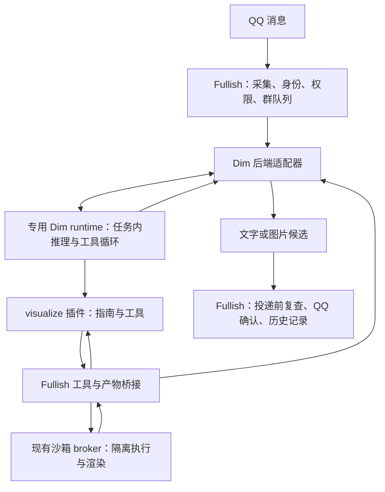

> 历史归档：2026-11-12。原路径 `docs/agent-runtime-plan.md`，来源提交 `10e11363c0dad4b194bd1020be3493a67dc3a68d`。
> 原因：用户确定由 Dim 插件直接渲染，替代原沙箱绘图合同。本文仅记录旧方案及其验收，现行说明见 [当前文档](../agent-runtime-plan.md)。

# Dim agent 与 visualize 插件开发路径

状态：开发设计；P0–P4 首版已实现，P5 已进入显式单群试运行并完成一次真实模型与 QQ 受控验收。日期：2026-11-12。Fullish 核对基线：`989f920`；Dim 包：`dimcode-alpha@0.1.0-alpha.20`。部署状态、证据与观察范围见 [接入与验证](../agent-runtime.md)。

## 目标与首个交付

Fullish 继续负责 QQ 群聊产品行为，接入 Dim 作为可替换的 agent 执行后端。visualize 成为第一个能力插件：根据群聊请求编写图形源码、离线渲染、查看并有限次修正，最终通过 Fullish 的公共发送服务交付 PNG。

第一版以“请画一张带中文标签的流程图”为完整验收任务，支持同轮修改一次。最终交付是图片；可访问的 HTML 页面、交互网页托管和跨轮编辑是另外的产品能力。原有 [Issue #42](https://github.com/weiuou/Fullish/issues/42) 的离线渲染、群隔离和统一图片投递边界继续适用。

后续按照“其他获授权工具 → 持续会话 → 后台任务”的依赖推进。一次性固定文字提醒保留为独立工作流，不依赖 Dim，见 [主动消息设计](../proactive-messaging.md)。

## 基线能力与设计增量

| 部分 | 基线代码（`989f920`） | 本方案增加的内容 |
| --- | --- | --- |
| 回复后端 | [ReplyModel](../../src/fullish/reply/schema.py) 接收上下文与可信 ToolContext，返回回复候选 | Dim 适配器、版本探测和后端选择 |
| 群聊上下文 | [ConversationStore](../../src/fullish/conversation/store.py) 保存有界快照，普通消息只提供上下文 | 第一版沿用快照；持续会话阶段再增加增量输入合同 |
| 编排与投递 | [ConversationService](../../src/fullish/reply/service.py)、[群队列](../../src/fullish/scheduling/queue.py)、[SendingService](../../src/fullish/sending/service.py) | agent 取消传播、结果转换与后端选择；继续确认后记历史 |
| 工具执行 | [ToolRuntime](../../src/fullish/tools/runtime.py) 负责授权、限流及 MCP/钱包调用 | 按运行授权的工具桥接，复用原执行入口 |
| 图片产物 | [ImageAssets](../../src/fullish/media/assets.py) 管理每轮图片 | 从渲染结果安全导入，交给模型查看和 Fullish 发送 |
| 沙箱 | 群独立的 Rootless Docker/gVisor，已有执行与图片传输 | 可选渲染镜像、固定 CLI、字体、离线依赖与探针 |
| 插件 | 基线尚无 Dim 插件 | visualize 的工具入口、绘图指南、主题和示例 |

## 架构与职责



- Fullish 决定是否响应、可信群和成员身份、可用工具、执行预算及投递目标。每个 QQ 事件只选择一个回复后端。
- Dim 负责一次任务内的推理、工具选择、结果检查和修正。Dim 接管的任务不再进入 Fullish 原有模型工具循环。
- visualize 插件提供能力描述与绘图流程，实际渲染经工具桥接进入沙箱。插件安装状态不能授予群权限。
- 插件返回候选产物，不调用 QQ。只有 Fullish 的发送确认可以证明群友已收到内容。
- 应用保持模块化单体；Dim 是同机独立运行进程，沙箱继续作为既有隔离执行服务。首版不拆出分布式调度系统。

## 必须先固定的接入合同

### 协议与版本

优先验证 `dima acp`，用结构化协议提交、接收结果与取消；`exec --json` 仅适合诊断原型，不以终端文本解析作为生产接入协议。若固定版本 ACP 无法提供必要的结果分类和停止证据，在 P0 决定改用公开 App Server 协议；生产适配器只选择一种已验收的控制通道。

记录实际二进制版本、包锁、运行时/插件 SDK、模型配置版本和能力握手结果。当前安装包要求的 rutis 范围与官方主线部分示例不同；主线协议和设计文档也有版本差异。依赖以固定发行版本的声明和真实探针为准，不能拼用不同版本示例。

当前核对到的 ACP 工具结果投影主要是文本，不能据此承诺 PNG 字节自动传回调用者。图片产物由独立桥接传回 Fullish；模型侧是否实际看到了 PNG，也必须在固定版本中验收。

最终回复必须有明确的提取合同：ACP 文本流可能包含调用工具前的中间说明，不能把全部文本片段拼接后发送。P0 验证如何识别最终文字，排除思考、工具活动与进度；若固定版本不能可靠区分，就通过受控的候选提交工具明确最终文字/图片，任务完成事件只作为投递门槛。

### 第一版会话：每任务独立

每次被叫到的消息建立一个独立 Dim session，用 Fullish 的一次上下文快照完成本次多步任务；同群继续使用既有 FIFO。普通未触发消息仍只进入 Fullish store。第一版可复用 runtime 进程，但不复用任务会话，也不启用自主后台目标或 agent 子分支。

这允许先接入完整的任务执行循环，又避免把每轮 60 条/6000 字快照重复追加到长期会话。群标识、成员和消息标识从真实事件绑定，引用和历史仍标为背景，不能提升权限。输入图片通过受控媒体读取与附件输入传递，验证文本、图片与引用的对应关系。

Dim 后端第一版关闭 Fullish 的额外表达后处理，由 Dim 的角色与回复约束控制表达；旧后端保留原行为。之后如恢复统一后处理，需要把实际投递内容而非初稿回注持续会话。

独立 session 仍可能把输入写进 Dim Timeline。P0 必须验证 close、delete 与附件清理的实际语义；测试只用合成输入。实群启用前明确私有状态目录、保留期限与清理机制，不能把“关闭会话”当作“已删除记录”，也不能把每任务会话宣传成自动无持久化。

### 工具与产物桥接

在 Fullish 一侧创建短期运行授权，绑定 `run_id`、群/成员/消息、session、截止时间和允许工具。身份与授权由受信任的适配层注入，不出现在模型可选参数里。桥接通信使用受保护的本地通道；认证材料不进入提示词、工具输出或日志。

现有工具通过 `ToolRuntime` 执行，保留工具展示、调用时和外部服务排队后执行时的权限检查。渲染桥接进入现有 broker，禁止暴露任意宿主机路径、Docker socket 或 bot 凭证。源码写入使用受限的 workspace 文件接口或经验证的编码写入方式，不把模型源码直接拼进 Shell 命令；如扩展文件接口，先补充 Issue 的合同和路径校验设计。

插件取得本轮产物句柄后可请求模型查看；提交最终候选时提供 `artifact_id` 与自然配文。Fullish 根据运行授权读取实际字节，校验格式、大小、作用域与有效期，再导入 `ImageAssets`。禁止把 agent 返回的任意路径直接包装成可发送的 `Path`。

候选登记与发送分开：只有任务成功结束、候选校验通过且投递仍获授权时才能发送。取消或失败后已生成的图片可以清理，但不能自动补发。沿用单轮最多一张发出图片、现有媒体容量限制；跨轮复用需在后续单独增加有期限的产物存储。

### 取消、失败与回退

运行至少区分：未提交、已受理、执行中、已完成、失败、取消已确认、状态不明。它们是适配层状态，不假定协议具有同名字段。

取消时先撤销本轮工具与产物提交授权，再发出明确停止请求并等待有界的停止确认；已被 broker 或外部服务受理的操作可能继续，需按执行方合同等待、终止或标为不明。Fullish 关闭 ACP 连接、取消 Python await，甚至收到 ACP `cancelled`，都不能单独证明底层执行已停止。无法确认时隔离该 session、不再复用；P0 验证如何回收专用 runtime 内残留任务及限制资源占用。

旧后端是配置级回退。单条任务只有在确认 Dim 尚未受理时才允许切换执行；已受理或状态不明的任务不自动换后端重跑。QQ 投递仍按 `confirmed/failed/unknown/blocked` 处理，结果不明不盲目补发。

P1 增加 Fullish 侧最小持久运行登记，建议独立 SQLite 文件保存于既有私有控制挂载。按真实平台、bot、群、消息身份生成稳定事件键，原子占用后才提交任务；保存 `run_id/session_id`、提交意图与受理状态、终态、投递开始和回执摘要。候选正文和图片不写入这份登记。Dim session 创建或提交前也要先记意图，响应丢失归为不明；投递前先持久记录开始，QQ 成功但本地回执未落盘同样归为不明。

重启将未决记录隔离为 `unknown`，相同事件重投只读登记，不新建任务、不自动补发；无法写入登记时拒绝启动该任务。明确事件去重记录保留窗口，未决记录不得按普通成功记录过期删除。第一版保证保留窗口内的去重与不明结果抑制，不承诺所有请求最终都会送达。这里没有可重放候选内容、任务重试或恢复调度，完整 Outbox 仍属于 P7。

配置切回旧后端时，新的路由层仍检查已有运行登记，不能让旧后端重新执行已占用事件。回滚到尚不认识该登记的旧二进制前，要停新请求并处理未决运行；旧版本不具备新增去重保证，不将其描述为无条件安全的自动回退。

第一版保留交互任务总时限，渲染单次沿用沙箱上限，并至多进行一次看图后的修正。模型请求额度、总 token/费用观测和工具调用上限在 P0 验证可强制执行的位置；不能只写进提示词。接入长期 agent 不等于允许无限占用群队列，超过交互期限的后台工作留待持久任务阶段。

沿用生成协调器管理执行名额，Dim 后端初始只开放一个并发任务；在现有服务器测量 bot、CPA、Dim 和渲染器共同运行时的峰值内存与延迟后，再调整并发。P0 测量单任务开销，P5 用真实部署挂载和受控负载验证整机余量。

### 专用运行环境

Dim 使用专用 home、工作目录和系统身份/容器，与个人 dima 会话、生产 bot 配置及钱包目录隔离。模型连接配置由维护者单独提供；只传所需环境变量。绘图使用预装受信任插件，群聊不开放插件安装/更新、系统管理或宿主机通用 Shell 权限。

验收有效工具集合与实际调用拒绝行为，确认插件或内置工具不能绕过桥接访问其他群文件。若固定版本无法满足这一点，停止实群 rollout，先解决隔离或收窄运行能力。

## visualize 插件的交付形态

以下保留设计时的目录划分，实际已实现的文件与验证命令见 [接入指南](../agent-runtime.md)。`assets/` 仍为后续静态资源的扩展位置。

```text
src/fullish/agents/             后端适配、协议、运行授权、结果与生命周期
plugins/visualize/
  dim-plugin.json               插件清单
  src/                          Dim 工具与桥接调用
  skills/                       选图、中文排版、主题、预览和修正指南
  assets/                       经许可证核对的主题/静态资源
  renderer/                     复制进沙箱镜像的固定离线渲染 CLI
deploy/Dockerfile.sandbox       普通目标 + 可选 visualization 目标
```

renderer 独立于 Dim，便于离线测试和替换 agent。依赖、Mermaid 包、浏览器与中文字体在可信构建阶段安装并固定版本；运行时禁止网络与非输入许可文件的子资源读取。明确可用的内联数据和打包资源清单，不能以全放行 `file:` 解决资源加载问题。检查嵌套 frame、CSS、字体、SVG 引用及浏览器下载等入口。

首个切片先完成固定中文 SVG 到 PNG，再接 Mermaid，最后接有界 HTML 片段。限制源文件字节、画布尺寸/像素、输出 PNG 字节和渲染时间，等待字体与渲染就绪后截图。输出只能落在本次 workspace 的受控路径。

保留 Rootless Docker/gVisor、断网、只读根目录及有界 CPU/内存/进程/超时约束。在真实环境验证浏览器及其子进程可启动、退出并被清理。开发验收发现普通镜像的 512 MiB/64 PIDs 不足以运行 Chromium；经 [Issue #43](https://github.com/weiuou/Fullish/issues/43) 的资源设计变更，可选 visualization 镜像使用独立的 1 GiB/128 PIDs 配置，保持 1 核和 Chromium 内层沙箱，普通镜像仍用原配置。安装该镜像须同步更新 broker/OCI 适配器并验证容量，不能改为宿主机或普通 runc 执行。

## 分阶段开发与验收门槛

| 阶段 | 可独立审查的交付 | 必须通过的验收 | 依赖与回退 |
| --- | --- | --- | --- |
| P0 接入原型与合同 | 固定 Dim 版本，真实协议探针，输入/最终回复/取消/产物/清理说明；补充设计 Issue | 本地模拟模型下完成文本、图片输入、工具结果看图、取消/断连/状态不明、权限拒绝；最终回复不夹带中间说明 | 所有后续基于本阶段结论；若 ACP 不足，先决定原生协议路线 |
| P1 文字 agent 后端 | `ReplyModel` 适配器；默认旧后端、显式选择测试群；每任务 session；最小持久运行登记、表达与预算 | QQ 入口到真实内部发送链：静默、两群隔离、同群 FIFO、错误提示、投递确认、关机取消；受理后崩溃及事件重投不新建任务 | 依赖 P0；停止接收新 Dim 任务并清理在途后切回旧后端，保留事件登记检查 |
| P2 工具与产物桥接 | 短期运行授权，沙箱执行/图片取回包装，媒体候选转换 | 跨群与过期句柄拒绝；排队后撤权；取消后无新调用；产物不明不发送 | 依赖 P1；撤销桥接授权，关闭 Dim 工具 |
| P3 离线渲染环境 | 可选镜像目标、固定 CLI、中文字体/离线依赖、部署探针 | 真实 rootless gVisor 内 SVG/Mermaid/HTML 分项验收；中文、路径边界、子资源拒绝、超时和子进程清理 | 可与 P1/P2 并行；失败不开放对应格式，普通镜像继续可用 |
| P4 visualize 插件 | 版本化指南、主题、工具；先图后改再交付 | 合成群消息 → Dim → 真渲染 → 模型看图 → 一次修改 → 发送确认；同时验证撤权/坏图/渲染失败 | 依赖 P2/P3；停用插件和可视化开关，文字 Dim 仍可用 |
| P5 单群试运行 | 镜像、固定插件与模型配置发布；运行探针、资源指标、运维回退说明 | 完成 Linux 部署验证及受控 QQ 实群验收；耗时/费用有界、取消无新副作用、无重复投递 | 依赖 P4；先停止新任务并处理在途，再回退配置和版本 |
| P6 更多工具与持续会话 | 分批接搜索/只读 CPA、已授权动态 MCP，最后钱包；另交付增量会话合同 | 已有工具权限和幂等回归；会话轮换、去重、断档与发送回执正确 | 工具扩展可在 P5 后独立推进；持续会话有自己的迁移与清理开关 |
| P7 后台任务与主动消息 | 一次性提醒、持久化投递，之后才接长期 agent 任务和额度告警 | 重启恢复、取消/撤权、结果不明、任务完成与投递完成分别可查 | 固定文字提醒可独立开发；后台 agent 交付依赖持久任务及显式主动授权 |

P0 是第一项开发任务。P3 的渲染试验可并行提前，但插件完整接线须等 P2/P3 都通过。阶段表示依赖，不要求每阶段只有一个 PR；渲染镜像和业务插件应分开审查。

建议首批 PR 标题依次为：

1. `test: validate pinned Dim integration contracts`
2. `feat: add an opt-in Dim reply backend`
3. `feat: bridge scoped agent tools and media artifacts`
4. `feat: add offline visualization sandbox target`
5. `feat: add the Dim visualize plugin`
6. `feat: validate and deploy the opt-in agent runtime`

接口、存储与部署设计已按 [贡献约定](../../CONTRIBUTING.md) 记录于 [Issue #43](https://github.com/weiuou/Fullish/issues/43)，关联 #42 的插件与渲染分工。首版已通过 [PR #44](https://github.com/weiuou/Fullish/pull/44) 合并部署，当前只对显式单群开放试运行。

## P6/P7 的明确边界

持续会话需要群到 session 的绑定、稳定 observation ID、消费游标、群 epoch、上下文断档/轮换规则，以及实际投递回执回注。会话只追加新观察，不能反复追加整份快照。Dim 中生成过的初稿仍属于草稿；投递失败、被改写、部分成功都要准确表示。聊天内容、Timeline 和产物的保留/删除与备份规则随该阶段一起交付。

现有 `image_id` 只在一轮有效。“把刚才那张改成蓝色”需有期限的群产物存储和重新导入规则，不能延长随机句柄寿命就当作持久媒体系统。

动态 MCP 注册和群授权继续由 Fullish 管理，经桥接向 Dim 提供已授权工具，不直接复制全部第三方凭证。钱包仍通过原专用适配器注入真实事件幂等键；Dim 不能指定群身份、签名文件或付款去重键。涉及写操作时，断线重试策略必须沿用执行方的幂等与结果不明合同。

固定文字提醒先走已有主动消息设计：提醒存储、显式通知授权、到期扫描与持久投递。Dim 的计划能力不能直接代替 QQ 的授权和回执账本。长任务在群队列外执行、完成后入队发送前，需要独立的任务身份、恢复和过期策略；这属于 P7，首版不靠无限延长交互超时实现。

## 验证方式与完成定义

优先复用 [消息流程](../../tests/test_message_flow.py)、[群队列](../../tests/test_message_queue.py)、[共享投递](../../tests/test_shared_delivery.py)、[MCP 撤权](../../tests/test_mcp_servers.py)、[媒体边界](../../tests/test_reference_images.py) 和 [钱包幂等](../../tests/test_wallet.py) 场景，模拟模型、QQ、链上 RPC 等外部边界，保持内部服务真实协作。

首版集中覆盖六组场景：

1. 中文图正常完成、看图修正一次，QQ 确认后仅记一条图文历史。
2. 同群连续请求按顺序完成；不同群既不串上下文，也不能读取对方产物。
3. 等待执行或准备发送时撤权，后续调用/投递被拒绝。
4. 渲染失败、中文字体缺失、依赖缺失、越界资源和超时均返回可解释失败。
5. 提交断连、任务取消、进程重启、QQ 回执不明不会自动重跑或重复发送。
6. 后端或插件停用后新任务使用明确配置，在途任务授权被正确撤销或完成清理。

证据分层记录：模拟协议与外部边界回放、固定 Dim 二进制与插件、真实浏览器、真实 rootless gVisor/部署挂载、受控真实模型与 QQ。每层只证明实际执行过的部分；本文件描述设计与门槛，实际验收结果以 [接入与验证](../agent-runtime.md) 中的分层证据为准。

交付门槛以“完整画图流程 + 原授权和发送语义正确 + 资源有界 + 可操作的回退”为准。观测关联 `trace_id`、`run_id`、session、后端/插件版本、阶段耗时、工具次数、可获得的 token 用量、取消结果和 QQ 投递状态；普通日志不保存群聊正文、源码、图片或凭证。

## 参考依据

- [Dim 官方入口与 ACP/MCP 定位](https://github.com/arcships/dim#clients-tools-and-model-protocols)：支持 agent 客户端接入；具体子集需固定版本核验。
- [ACP 映射与生命周期](https://github.com/arcships/dim/blob/main/docs/design/acp-gateway-implementation.md)：控制通道、结果投影和停止的不确定性。
- [App Server](https://github.com/arcships/dim/blob/main/crates/dim-app-server/README.md)：公开会话接口、插件宿主及提交结果不明语义。
- [插件编写示例](https://github.com/arcships/dim/blob/main/runtime/plugins/plugin-authoring/skills/plugin-authoring/SKILL.md)：清单、工具与生命周期；示例 SDK 版本不直接作为本项目依赖版本。
- 本机已安装包的 `package.json`、`plugin.d.ts`、`client-protocol.d.ts` 和 `dima --help`：确认 alpha.20、ACP/exec 入口以及工具结果/客户端投影类型；类型存在不等于已完成集成验收。

以上主线链接可能继续变化，P0 应把实际验收版本、源码 revision 和探针结果固定到对应实现 PR。
