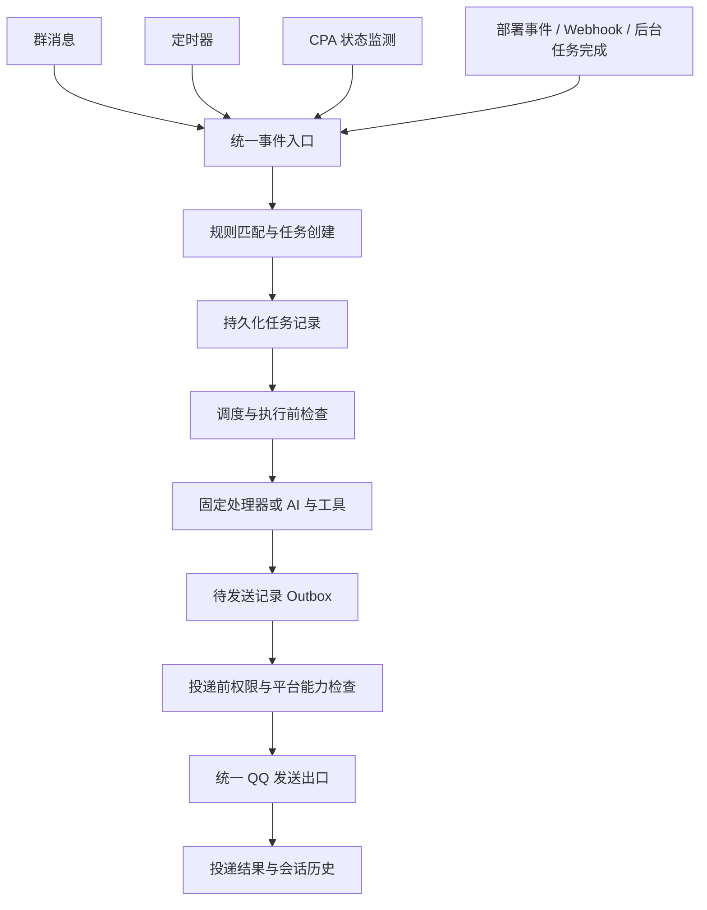

# 主动消息与触发器架构草案

状态：主动消息与触发器设计草案。公共群协调与发送边界已完成重构，提醒及持久化投递尚未实现。日期：2026-11-03。

Fullish 的主动消息能力将建立在统一的事件、任务调度和投递机制上，支持定时提醒、CPA 额度告警、部署通知、后台任务完成通知，并为未来主动参与群聊提供基础。继续采用单机、单实例的模块化单体，第一版使用 SQLite 持久化自动化状态。

实施顺序为：统一发送出口与投递记录，建立可恢复的定时任务，再接入状态告警和外部事件，最后加入自主发言决策。事件发生、任务执行、消息投递分别记录，允许任务完成后不产生消息。

## 本次最小闭环

下一次功能交付范围为可恢复的一次性文字提醒。当前已完成 [消息主链重构](architecture.md#模块职责与依赖)，各部分状态如下：

| 模块 | 本次职责 |
| --- | --- |
| `sending.service` | 聊天与部署简报已共用投递服务和群协调；提醒接入、持久化投递与新增主动授权待实现 |
| `reminders.store` | SQLite 保存目标群、到期时间、文字、创建者与执行、投递状态 |
| `reminders.scheduler` | 简单到期扫描、启动恢复、有效期处理和按失败类型决定重试 |
| 开发者菜单扩展 | 已绑定开发者添加、查看、取消提醒和查看结果；按群显式授权主动消息 |

提醒只发送已保存的文字，不调用模型或 MCP，因此本次不实现通用后台执行身份、周期规则、事件总线或规则引擎。存储仍须区分任务执行完成与消息确认投递，不确定的发送结果不得盲目重试。用正常发送、重启恢复、取消、撤权和结果不明的完整场景验收。

下文描述长期扩展边界；其中周期计划、通用 Rule/Run、后台 MCP 委托、CPA 告警与自主插话均属于后续范围，不能据此扩大本次实现。

## 当前能力与需要调整的边界

| 当前实现 | 可复用部分 | 需要调整的边界 |
| --- | --- | --- |
| [群消息处理](../src/fullish/platforms/qq/adapter.py) | 事件转换与平台接入，业务处理已移入 `reply.handler` | 提醒使用独立主动传输，不伪造入站事件 |
| [每群队列](../src/fullish/scheduling/queue.py) | 聊天与部署简报共享 FIFO、背压、停机排空与等待结果 | 当前任务仍在内存中，不能跨重启恢复，也没有优先级和有效期 |
| [会话存储](../src/fullish/conversation/store.py) | 群上下文、去重与快照；生成并发、群策略已移至独立服务 | 采集时机仍在群 FIFO 中，自主发言阶段再解耦 |
| [发送模块](message-sending.md) | 统一表示、附件预检、逐条权限/预算复查与内存投递结果 | 增加持久化 Outbox；表达后处理由 `reply` 编排 |
| [部署简报](../src/fullish/notifications/report.py) | 已迁入公共队列和投递服务，保留平台能力查询与原有通知授权 | 为提醒增加独立授权，不继承部署通知配置 |
| [MCP 注册与运行](mcp.md) | 动态发现工具、按群授权、执行时权限复查 | 后台任务需要明确的执行身份和更细的工具范围 |

本设计新增自动化持久化，不要求把所有群聊天内容持久化。现有交互回复已迁入公共调度与投递边界并保持行为兼容；当前投递结果不跨重启保存。

## 总体流程

触发源负责报告事实；规则决定是否创建任务；执行器产生结果；发送服务决定结果能否、何时投递。任何触发器、MCP 适配器或内容生成器都不直接调用 QQ 发送接口。

交互回复和自动化任务最终共享每群协调与发送服务。可以保留不同的入口和持久化策略，但不能各自建立互不协调的群发送队列。

## 事件与自动化规则

### 触发源

| 类型 | 示例 | 主要职责 |
| --- | --- | --- |
| 时间 | 半小时后提醒、每天早上汇报 | 计算到期时间，产生一次计划发生记录 |
| 内部或外部事件 | 部署成功、后台计算完成、Webhook | 验证来源，将事件转换为统一结构 |
| 状态变化 | CPA 额度跌破阈值、异常恢复 | 获取状态、比较前后变化、抑制重复告警 |
| 会话活动 | 收到普通消息、话题发生变化 | 提供发言候选所需信号，后续阶段再启用 |

统一事件至少包含 `event_id`、`type`、`source`、`occurred_at`、`scope`、`dedupe_key`、`payload` 和 `schema_version`。时间以 UTC 保存；面向用户的计划另外记录 IANA 时区，例如 `Asia/Shanghai`。

外部事件的正文是数据。接收群、执行权限和处理器由本地已授权规则决定，不能直接采用外部 payload 指定的任意目标或指令。Webhook 入口需要认证、重放防护和大小限制。

### 规则定义

一条自动化规则描述“何时、在什么条件下、为哪个群、以什么权限执行什么动作”。

| 字段类别 | 内容 |
| --- | --- |
| 身份与作用域 | 规则 ID、创建者、目标群、启用状态、版本 |
| 触发与条件 | 事件类型、一次性时间或周期计划、结构化匹配条件 |
| 执行动作 | 已注册的动作类型、通过 schema 校验的参数、工具允许列表 |
| 调度策略 | 优先级、有效期、静默时段、冷却、群通知预算 |
| 恢复策略 | 迟到后补发、合并为一次或丢弃，最大补执行数量 |

首版用有限的条件与处理器注册表，不接受任意 Python 表达式或脚本。模型可以将自然语言转换为规则候选，由程序校验权限、目标群和参数后保存。只有持久化成功，才能向用户确认规则已建立。

例如“每天早上 9 点汇报 CPA 额度”，应转换成一条有时区、目标群和只读工具授权的周期规则。配置操作要能列出、查看、暂停、恢复和删除规则，并显示下一次触发时间与最近一次结果。

首版规则管理沿用已绑定开发者的私聊菜单。是否开放给普通群成员、允许创建哪些规则，作为后续独立权限设计。

## 调度与持久化

### 持久化对象

第一版使用持久卷中的 SQLite，建议独立保存为 `automation.sqlite3`。数据库内至少区分规则、任务执行、待发送记录和监测状态；数据库迁移使用版本号与兼容新增策略，并纳入备份与恢复流程。

| 对象 | 关键内容 |
| --- | --- |
| Rule | 规则定义、版本、下次触发时间、当前启用状态 |
| Run | 规则版本、触发事件或计划时刻、动作与参数、状态、尝试次数、租约、截止时间 |
| Outbox | 已确定的消息内容、目标、发送模式、投递状态、平台回执、重试时间 |
| MonitorState | 上次有效观测、当前告警阶段、去重键、观测时间 |

任务保存 `action_type + 参数`，执行时由处理器注册表解析，不持久化 Python 闭包、QQ 事件对象或连接对象。计划触发、唯一任务创建和下次触发时间推进应在同一事务中完成；任务产出 Outbox 与执行状态更新同样原子提交。

周期任务以“规则 ID + 规则版本 + 计划触发时间”作为唯一发生标识。事件任务以“规则 ID + 规则版本 + 事件去重键”标识。数据库唯一约束作为最终去重依据。

### 运行状态与恢复

任务可处于 `pending`、`running`、`retry_wait`、`completed`、`failed`、`cancelled` 或 `expired`。`completed` 表示动作执行完成；通知是否送达由 Outbox 单独表示。

执行器通过原子领取和租约标识拥有任务。过期租约可被恢复流程识别，旧执行器提交结果时必须校验领取标识。租约本身不能防止外部副作用重复执行，因此动作还须声明恢复策略：只读查询可有界重试，写操作需要自己的幂等能力，否则进入人工处理状态。

重启后只恢复仍有效且允许恢复的任务。重复计划不能按停机期间的每个时间点无限补发；每条规则明确采用补一次、合并或丢弃策略。规则暂停、删除或修改后，排队任务应检查规则版本与当前状态，默认取消旧版本未开始的任务。

### 群内协调与预算

同群任务共享协调器，待执行任务支持优先级；用户明确 @ 的交互请求通常优先于普通通知。群间公平取任务，避免单群占满全局模型名额。保持既有生成并发限制，并分别限制后台查询、模型调用与通知数量。

优先级首先作用于未开始的任务。已开始的发送计划保持顺序；首版不强行打断正在生成的回复。自动化动作需要有界超时，避免长任务长期阻塞该群。

静默时段推迟普通通知，但不得超过消息有效期。是否允许某种告警绕过静默时段必须显式配置。低优先级任务设置最大等待时间和合并策略，防止一直排队或在恢复后集中刷屏。

## 执行身份与 MCP 权限

现有 `ToolContext` 要求真实 `sender_id` 和 `message_id`。自动化任务不能填入伪造的用户身份来绕过检查，应增加统一的执行上下文，区分交互身份和自动化身份。

| 身份 | 必要来源 |
| --- | --- |
| 交互请求 | 真实群 ID、成员 ID、入站消息 ID |
| 自动化任务 | 目标群、规则 ID、规则创建者、执行 ID、规则授予的工具范围 |

自动化任务的有效权限为：规则获准的工具与动作、目标群当前授权、工具自身限制三者的交集。规则获准时记录的权限是上限，不能因为以后 MCP 新增工具而自动扩大。

CPA 告警只授予额度查询能力。即使同群开放钱包，后台额度任务也没有转账权限。首版自动化只开放明确列出的只读工具与通知处理器；需要用户身份或具有外部写入副作用的工具另行设计委托机制。

权限在任务启动、工具调用以及实际发送前复查。撤销群 MCP 授权、关闭主动消息或暂停规则，都应使尚未完成的相关操作停止。MCP 的只读声明可辅助分类，但不能代替本地工具允许列表。

MCP 提供查询与执行能力，bot 核心负责调度、恢复和投递。未来支持事件订阅的 MCP 可以通过独立适配器产生统一事件；普通 MCP 工具发现不会自动创建后台监测任务。

## 统一消息投递

### 发送目标与发送模式

复用 `OutgoingMessage` 和 `ReplyPlan`。新增独立于入站事件的发送请求，包含目标群、消息来源、主动或回复模式、可选回复关联、有效期和投递标识。

被动回复保留真实入站消息关联及回复序号预算。主动通知不借用过期消息 ID，也不伪造入站事件。部署简报已迁入同一发送出口，作为现有主动发送行为的兼容性样例。

表达后处理由动作策略决定。普通聊天可继续使用；额度、重置时间等结构化通知优先使用确定性模板，必要时再允许模型组织说明。消息内容确定并写入 Outbox 后，投递重试复用同一内容，不重新生成。

若后续支持持久化媒体通知，附件必须引用有保留期的持久资产，不能保存仅在当前进程或单轮会话中有效的图片 ID。首个定时提醒样例只发送文字。

### 投递结果与重试

Outbox 区分 `pending`、`sending`、`retry_wait`、`confirmed`、`failed`、`unknown`、`cancelled` 和 `expired`。多条消息的计划逐条记录结果，已确认部分不重发；每条发送前复查剩余计划权限。

明确可重试且确认未投递的失败使用有上限的退避。权限拒绝停止投递；限流按平台反馈等待，并检查有效期。超时或进程退出导致无法判断平台是否接收时，标记 `unknown`；没有平台幂等或状态查询依据时，不自动重复发送。

SQLite 去重无法保证外部平台恰好收到一次。特别是平台已接收、进程尚未保存回执就崩溃时，必须保留结果不明状态。不得把所有中断都当成未发送来恢复。

只有平台确认的消息才记入正常会话历史，并保留来源类型，避免把通知当作用户请求。平台确认只表示 API 接受，不代表群成员已经阅读。投递记录应能说明“为什么没发”，而不只记录异常堆栈。

### QQ 能力边界

将主动消息能力查询、发送模式、回复窗口和平台限流封装在 QQ 适配层。群内主动消息开关与普通聊天开关分开表示，并为具体通知规则授权；不能从“允许聊天”推导出“允许所有主动通知”。

现有部署简报查询 `allow_proactive_msg` 后调用群消息接口。QQ 官方公开文档同时保留了 2025 年主动推送调整公告，因此实际可用能力应通过账号配置、群状态和真实接口结果验收，不把文档中的固定配额写入通用规则引擎。[QQ 官方发送消息文档](https://github.com/tencent-connect/bot-docs/blob/main/docs/develop/api-v2/server-inter/message/send-receive/send.md)

平台不允许发送时，任务记录明确的阻止原因，并按规则到期取消或等待权限恢复。不能静默改发其他群或私聊，也不能持续探测性重发。

## CPA 告警样例

规则示例：某个账号的 Claude/GPT 周额度首次低于 10% 时，向已授权群通知。监测键包含账号代号、额度池和窗口类型，避免将不同模型或账号的配额混为一谈。

1. 周期触发只读查询，取得剩余比例、窗口重置时间和观测时间。
2. 程序与上一有效状态比较；从正常进入低额度状态时创建一个告警任务。
3. 持续低额度期间抑制重复告警。可设恢复阈值为 15%，避免 10% 附近抖动；这些数值属于可配置示例。
4. 额度重置或恢复到正常范围后重新允许触发。账号、额度池或窗口变化需要更新监测状态。
5. 查询失败、过期缓存或未知额度不当作 0%。数据不可用告警如有需要，使用独立规则。
6. 投递前检查通知是否仍有效；已恢复或已过重置窗口的旧告警取消或更新，避免发送失效信息。

相同 CPA 查询可以在明确的共享数据源范围内合并，避免每个订阅群重复调用上游；结果分发仍逐群检查授权。模型只在需要说明时参与，不负责每次轮询的阈值判断。

## 自主参与聊天

主动通知与自主插话共享执行和投递基础，但需要不同的发言决策。确定性提醒由规则直接产生任务；自主插话先产生候选，再决定是否值得回应。

候选筛选先使用低成本信号，例如话题相关性、最近机器人发言时间、群活跃度和剩余预算，再按需要调用模型。避免每条普通消息都启动完整模型与工具流程。

候选应包含所依据的会话版本和短有效期。开始生成及投递前检查话题是否变化；过期候选可以沉默或取消，不保证每个候选都输出消息。默认忽略机器人自身消息作为触发源，并记录因果关联、限制事件链深度，避免通知触发通知的循环。

此阶段需要先改善上下文采集：当前普通消息也在群 FIFO 中处理，长回复期间到达的消息尚未进入会话状态。要让过期检查及时生效，应将轻量消息采集与发言执行解耦，再通过会话版本和快照协调一致性。

## 模块划分建议

以下为拟新增的逻辑职责，具体文件布局在实现时确定。

| 模块 | 职责 |
| --- | --- |
| `automation.events` | 统一事件结构、来源验证与去重标识 |
| `automation.rules` | 规则 schema、授权、版本、匹配与管理接口 |
| `automation.store` | SQLite 事务、执行与投递状态、租约、兼容迁移 |
| `automation.scheduler` | 到期任务、恢复策略、预算与群间公平调度 |
| `automation.actions` | 固定处理器与受限 AI 执行入口 |
| `automation.monitors` | CPA 等状态采集、阈值变化与告警恢复 |
| `sending.service` | 统一投递检查、发送结果和会话记录 |
| QQ 适配层 | 平台能力、回复关联、媒体编码和 API 错误分类 |

业务逻辑依赖上述接口，不依赖特定定时库。第一版不引入 Redis、Celery、Kafka 或独立调度服务；后续只有多实例或实际负载需要时才替换存储和领取实现。

## 实施路线与验收

| 阶段 | 交付范围 | 验收标准 |
| --- | --- | --- |
| 1 统一发送 | 公共发送服务、主动消息权限、投递记录；迁移部署简报 | 普通回复和媒体计划行为兼容；两类消息共享群协调；权限撤销有效；部分成功与结果不明可追踪 |
| 2 最小自动化 | 持久化规则与执行记录、一次性与周期提醒、管理菜单、受限执行身份 | 重启恢复不重复创建任务；时区与迟到策略正确；暂停和取消阻止未完成投递；只读任务不获得写权限 |
| 3 状态与事件 | CPA 额度告警、后台任务完成、经认证的 Webhook | 阈值抖动不刷屏；未知数据不误报耗尽；撤权后不查询或分发；重复事件只创建一次任务 |
| 4 自主发言 | 会话采集解耦、候选筛选、沉默决策、话题有效期 | 不抢占明确请求；过期候选不补发；可限制成本和频率；自身消息不形成循环 |

上表是长期演进路线。阶段 1 的公共发送和群协调已完成，持久化记录及新增通知授权仍待实现。首个提醒交付仅取阶段 1 剩余内容与阶段 2 中的一次性文字提醒部分，按本文开头的最小闭环验收；周期规则和通用执行身份后移。后续再用 CPA 告警检验状态型触发器的复用能力。

验证优先使用少量完整场景：正常到期发送、重启恢复、取消或撤权、部分成功与结果不明。场景使用可控制的时钟、假 QQ 传输和临时 SQLite，保留真实内部调用链，以关联 trace 和最终数据库、投递、会话状态断言证明行为；不逐函数铺设单测或追求覆盖率。仅对场景难以覆盖的关键逻辑补少量单测，已有检查继续保留。模拟回放与真实集成证据分别报告，生产消息验收单独在指定测试群进行。

日志用事件 ID、规则 ID、执行 ID 和投递 ID 串联，保留安全的原因码。开发者菜单应能看到待执行、失败、被抑制、过期和结果不明的记录；不把凭证、完整群聊内容或上游认证数据写进自动化日志。

## 审阅时需要确定的产品选项

这些选择不影响先抽取统一发送出口，但在相应功能上线前需要确定。

| 选项 | 建议起点 |
| --- | --- |
| 谁能创建规则 | 首版仅已绑定开发者；后续再开放群内个人提醒 |
| 哪些群启用主动消息 | 按群显式开启，并单独授权通知类型 |
| 默认静默时段与每日预算 | 可配置；在测试群试运行后确定实际默认值 |
| 停机错过提醒怎么办 | 一次性提醒在有效期内补一次；周期摘要默认合并或跳过 |
| 是否自动使用 AI 改写通知 | 结构化提醒与额度告警默认模板输出 |
| 何时允许自主插话 | 完成可靠投递和事件告警后，单独按群试运行 |
