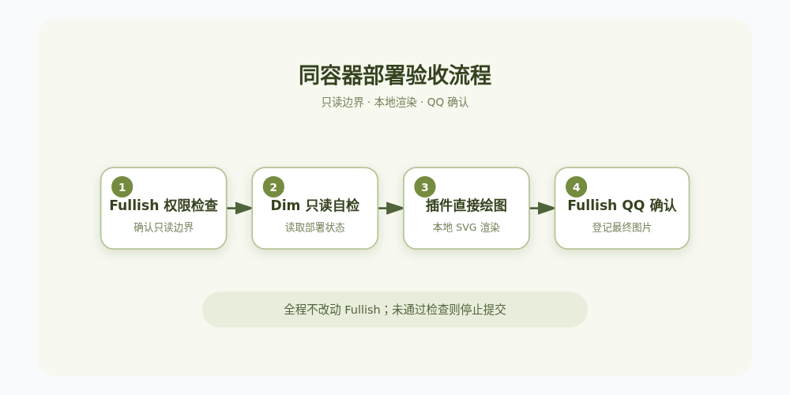

# Fullish 与 Dim 同容器及只读自检

状态：已上线，显式单群试运行。2026-11-13。用户要求及接口、权限、迁移合同见 [Issue #50](https://github.com/weiuou/Fullish/issues/50)，原独立 companion 的兼容部署与历史验收见 [接入记录](agent-runtime.md)。

## 权限边界

一个容器内运行 Fullish 与真实 Dim/rutis 两个进程树，分别使用 UID 10001 与 10002，通信组为 10003。启动器只用 SETUID/SETGID 创建两个非 root 角色，随后自身降为 65534、清空环境；角色之间不继承凭证。运行时保持只读根目录、no-new-privileges、1 核、1 GiB、256 PIDs 和无 swap。两者共享容器生命周期与资源，任一角色退出都会有界停止另一角色，再由容器重启恢复；未决任务不重放。

| 内容 | Fullish | Dim |
| --- | --- | --- |
| `/opt/fullish-readonly`：同版本源码及现行文档 | 只读 | 只读 |
| `/app/.venv`：实际运行代码 | 只读 | 只读 |
| `/var/lib/fullish/control`、钱包与审计 | 所属 UID 读写 | 无私有数据访问 |
| Fullish 私有凭证与进程环境 | 所属 UID 可读 | 不可读 |
| `/var/lib/fullish-diagnostics`：脱敏部署元数据 | 写入，文件 0640 | 组只读，目录不可写 |
| Dim home、任务及临时目录 | 仅共享任务目录 | 自有目录可写 |
| RPC 与候选桥接 | 指定 UID/GID 的 0660 socket | 指定 UID/GID 的 0660 socket |

RPC 两端目录各自由所属 UID 管理，另一方只有组遍历/读取权限，不能替换对方 socket。Dim 原生 endpoint 仍位于其 0700 私有目录并保持 0600，由同 UID 的 Unix 字节代理提供 0660 共享端点；客户端同时核对文件身份和内核 peer UID/GID。旧 companion 的同 UID/0600 验证仍保留，仅显式 `DIM_DEPLOYMENT=unified` 使用固定双 UID 合同。没有 Docker socket、重启或任意宿主机命令工具。Dim 对 Fullish 的只读限制由文件系统与 Linux 身份执行，不能被群聊提示词解除。

## 群聊自检

显式开启 `DIM_INSPECTION=true` 后，本轮获准 Dim 群可调用：

- `fullish_inspect`：列目录或读取固定源码视图，每次最多 120 行、12 KB；拒绝绝对路径、越界、链接、隐藏路径及写操作。生产配置值和密钥不在源码视图中。
- `fullish_self_check`：返回真实 UID、当前群权限、只读与 capability 检查、运行版本及最近脱敏部署事件；可在图片权限下执行一次固定绘图探针。自检不创建 QQ 回复，也不能修改 Fullish。

这些工具沿用 run/session 的授权、期限与调用预算，撤权后不可再读或投递；最终仍由 `fullish_reply` 登记候选，经公共出口确认后记历史。原生隐藏 exec 未开放。旧的绘图管理方法 `visualize.probe` 继续用于部署探针。

Fullish 只导出最多 40 条部署/服务元数据，文件最多 64 KB，不包含聊天正文、diff、提示词和凭证。摘要流程记录读取 GitHub 历史与模型生成的开始、完成、错误和耗时；总超时仍为 180 秒。旧版本仅有总超时的记录不能据此追溯出当时的具体阶段。

## 镜像与部署

```sh
docker build --target unified --build-arg APP_REVISION=<源码提交> -t fullish:unified .
```

主 CI 发布此 target，默认仍是原非 root Python 单进程入口；普通 `docker build` 继续构建 slim foundation。只有显式安装 [compose.unified.yaml](../deploy/compose.unified.yaml) 才启动双角色。它不能与 `compose.agent.yaml` 同时启用。

集成配置通过宿主机回环连接 CPA，Fullish 只监听 `127.0.0.1:18080`，Dim 仅开放私有 Unix RPC。覆盖文件使用 Compose `!reset` 清空原端口映射；需要现有指南要求的 Compose 版本。

维护者保留原 `runtime.env` 和仅含 Dim 模型元数据的 `agent.env`，准备三个私有普通文件：

| 路径 | UID/GID | 模式 |
| --- | --- | --- |
| `integrated-secrets/model-key` | 10002/10003 | 0600 |
| `integrated-secrets/bridge-fullish` | 10001/10003 | 0600 |
| `integrated-secrets/bridge-dim` | 10002/10003 | 0600 |

两份 bridge token 内容相同且至少 32 字符，各由所属进程读取；不要通过放宽旧文件权限共享凭证。使用新的 integrated home/work/RPC/diagnostics 卷，保留旧 companion 卷。运行配置包含 `AGENT_BACKEND=dim`、明确的 `DIM_ALLOWED_GROUPS` 和 `DIM_VISUALIZATION=true`，其他路径由覆盖文件固定。

部署前 `compose run ... python -m fullish.agents.check --preflight` 在自己的临时 home、工作区和 RPC 中启动候选 Dim，不替换活跃实例的 socket，不调用模型或 QQ。Fullish 保留组 10001 以访问既有 broker 挂载，Dim 不继承该组；发布后的检查和简报 CLI 用 UID/GID 10001 并加入通信组 10003 执行。

## 首次迁移与回退

先在原 companion 配置下发布兼容的新主镜像，确认其健康。再备份环境、覆盖文件和发布状态，暂停新绘图并排空或停止在途任务；停止旧 companion，安装同容器覆盖文件和新的凭证/卷，用同一已验证镜像切换。旧 companion 保留但不并行运行。首次迁移失败时，协调恢复旧配置及 companion，再启动原健康镜像。

后续兼容镜像可沿用原部署回滚。若目标镜像缺少 `org.fullish.unified-runtime=true` 标签，部署在停止现有 sender 前拒绝；恢复旧二进制前必须同步恢复保存的 companion 配置。不要删除状态卷或自动补发不明消息来完成回退。

## 验收边界

[单容器场景](../tests/unified_agent_integration.mjs) 使用实际 Linux、双 UID、固定 Dim/rutis 与 Chromium；仅模型和 QQ 为模拟边界。它检查源码/状态/诊断/凭证和 `/proc`、进程信号、root 恢复的实际权限，以及自检、源码阅读、两次 PNG 到模型、最终字节与确认后历史；另核对独立 preflight 不改变活跃 RPC 且零模型调用。

镜像中的源码及文档视图是对应构建版本的快照，当前运行方式应以 `fullish_self_check` 为准。命令执行与任意文件写工具尚未开放。

## 2026-11-13 上线及验收记录

[PR #51](https://github.com/weiuou/Fullish/pull/51) 合并为 `e78a45356cd84b97f54c410d683e1180fae0d89b`，经[主分支流程](https://github.com/weiuou/Fullish/actions/runs/43260697528)先发布兼容镜像，再协调切换为单容器。运行镜像为 `ghcr.io/weiuou/fullish@sha256:cc243b36f40454bce09df6108f5470cc68318e42a19efbd111554bf5b37a462f`；旧 companion 已停止，配置、密钥与旧卷保留用于回退。仍只开放原试运行群，没有扩大群授权。

[候选 CI](https://github.com/weiuou/Fullish/actions/runs/43258208997) 通过 638 项测试、28 个部署事务场景、旧 companion 兼容及真实单容器完整回放。服务器候选也通过真实内核检查：Dim 可读源码、写自己的目录，但不能写 Fullish 源码、状态或诊断，不能读 Fullish 私有凭证及进程环境、不能向其发信号或恢复 root。迁移后重新核对了实际进程 UID、文件边界、QQ ready、沙箱/钱包/Dim 发布后探针及 1 GiB/256 PIDs 限额。

受控真实 `gpt-6-luna` 在同容器内调用了 `fullish_self_check` 和 `fullish_inspect`，读取摘要源码后进行两次绘图。共 7 次模型请求，约 65.9 秒至真实 QQ 图文确认，确认后只记录一条回复。PNG 为 1000 × 500、51150 字节，SHA-256 为 `b6b37e85fe98bad680c295df3a90678ce415c8f51fb512cf25e50cc934ad9c12`。验收使用明确标记的部署输入，未伪造 QQ 入站事件；长期质量、费用和正常群聊仍需观察。



现有部署摘要仍使用独立的 Fullish 模型链路；本次增加诊断可见性，没有修改其模型选择或 180 秒预算。旧失败元数据已脱敏保留，后续新记录可以区分历史读取与模型阶段。自检能提供证据，不会自行修改配置或重启 Fullish。
